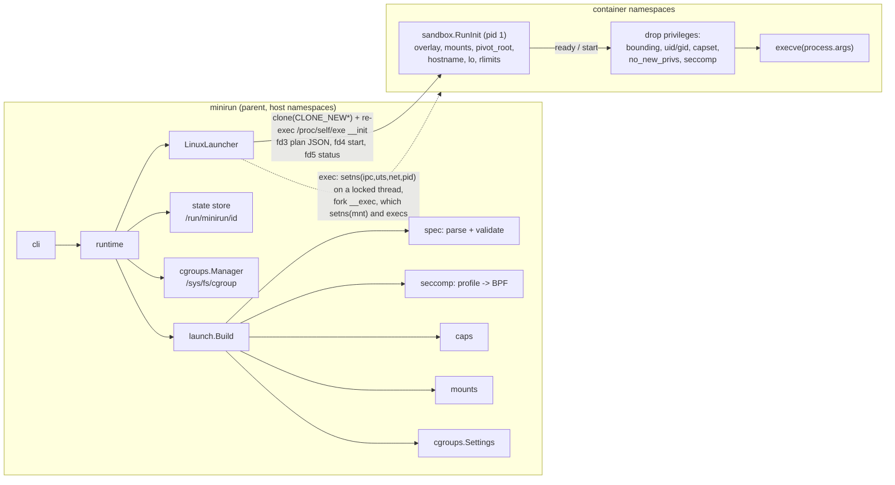

# minirun

A minimal OCI-style container runtime for Linux, written in Go with one
dependency (`golang.org/x/sys`). It reads a subset of the OCI runtime-spec
`config.json`, builds a container from Linux primitives (namespaces, cgroup
v2, overlayfs, `pivot_root`, capabilities, seccomp) and manages its lifecycle
with `run | exec | ps | kill | delete`.

It is a teaching-grade, fully tested implementation of what `runc` does at
its core, small enough to read in an afternoon. It is **not** a hardened
production runtime; see [Security caveats](#security-caveats).

## Who it is for

- Engineers who want to see exactly which syscalls make a container, in
  order, with the reasons for that order written down next to the code.
- People learning seccomp: minirun compiles OCI seccomp profiles to classic
  BPF itself (no libseccomp), and can disassemble the program and evaluate
  syscalls against it on any OS.
- Reviewers who want a container runtime whose isolation claims are checked
  by an automated suite against a real kernel.

## What it does

| Area | Implementation |
|---|---|
| Namespaces | pid, mount, uts, ipc, net (loopback brought up), user (uid/gid maps, `setgroups` denied), cgroup |
| cgroup v2 | creates `minirun/<id>`, delegates controllers along the path, converts OCI `memory`/`cpu`/`pids`/`unified` limits (runc's conversions), `cgroup.kill` teardown, stats incl. OOM kills |
| Root filesystem | overlayfs (bundle rootfs read-only lower, per-container upper in the state dir), OCI mounts with symlink-safe target resolution, host devices bind-mounted, `pivot_root(".", ".")`, masked and read-only paths, read-only root |
| Privileges | bounding set trimmed, `capset` of effective/permitted/inheritable, ambient set, `no_new_privs`, uid/gid/supplementary groups, rlimits, umask |
| Seccomp | OCI profile -> classic BPF compiler in pure Go: all 7 argument operators on 64-bit args, all actions except `NOTIFY`, x86-64 and arm64, balanced range-tree dispatch, trampolines for long jumps; Docker-like default allow-list |
| Lifecycle | `run` (foreground with signal forwarding and exit code, or `-d`), `exec`, `ps`, `state`, `stats`, `kill [--all]`, `delete [-f]`; state in `/run/minirun/<id>` with `flock` and pid-reuse-safe status |
| Inspection | `spec` (generate config), `validate` (reports ignored keys), `plan` (every step a launch would take, optionally replayed on a fake cgroupfs), `seccomp` (compile, `--disasm`, `--check`, `--cost`) |

## Architecture



The parent turns the bundle into a **launch plan**: a validated, JSON
document that says exactly what to do. The child (`minirun __init`, the same
binary re-executed into new namespaces) executes it without making decisions
of its own. The parent moves the child into its cgroup only after the child
reports ready, immediately before releasing it to `execve`, so the Go
runtime's own threads never count against a tight `pids.max`.
[docs/ARCHITECTURE.md](docs/ARCHITECTURE.md) covers the process protocol,
the mount and privilege-drop sequences, the seccomp compiler and the
complexity of each step.

## Quickstart

Requirements: Go 1.26+. Running containers needs Linux 5.11+ with cgroup v2,
overlayfs and root. Everything else (unit tests, demo, `plan`, `seccomp`)
works on macOS too.

```sh
make check          # fmt + lint (darwin and linux) + vet/build for linux/amd64,arm64 + tests + coverage floor
make demo           # offline end-to-end demo, no root or Docker needed
make integration    # real containers inside a privileged Docker container (skips without Docker)
```

On a Linux host, as root:

```sh
make build
mkdir -p bundle/rootfs
curl -fsSLO https://dl-cdn.alpinelinux.org/alpine/v3.20/releases/x86_64/alpine-minirootfs-3.20.3-x86_64.tar.gz
tar -xzf alpine-minirootfs-3.20.3-x86_64.tar.gz -C bundle/rootfs
cd bundle && ../bin/minirun spec --memory 64M --pids 32 -- /bin/sh && cd ..
sudo bin/minirun run --bundle bundle --rm demo          # interactive shell, pid 1 in its namespace
sudo bin/minirun run --bundle bundle -d web             # detached
sudo bin/minirun exec web ps
sudo bin/minirun ps
sudo bin/minirun delete -f web
```

The state directory must not be on overlayfs (overlayfs refuses an upper
layer on another overlayfs); the default `/run/minirun` is tmpfs on
mainstream distributions.

## Demo output

Excerpt of `make demo` on macOS (full run in the
[build report](#benchmarks-and-evaluation); the script is
[scripts/demo.sh](scripts/demo.sh)):

```text
==> 4. The launch plan, step by step, with the cgroup writes replayed on a fake cgroupfs
[1] namespaces  clone flags 0x6c020000: ipc, mount, network, pid, uts

[2] cgroup /sys/fs/cgroup/minirun/demo
    delegate +cpu +memory +pids along the path
    write cpu.max          = 50000 100000
    write memory.max       = 33554432
    write memory.swap.max  = 0
    write pids.max         = 16
...
[5] privileges  uid=0 gid=0 no_new_privs=true
    bounding    00000000a80425fb  (14 caps)
    effective   00000000a80425fb
    seccomp SCMP_ARCH_X86_64: 302 rules -> 105 BPF instructions over 64 syscall ranges, default SCMP_ACT_ERRNO(1)

simulated cgroupfs writes (fake hierarchy at /tmp/.../cgroupfs):
  echo "+cpu +memory +pids" > /sys/fs/cgroup/cgroup.subtree_control
  echo "+cpu +memory +pids" > /sys/fs/cgroup/minirun/cgroup.subtree_control
  echo "50000 100000" > /sys/fs/cgroup/minirun/demo/cpu.max
  echo "33554432" > /sys/fs/cgroup/minirun/demo/memory.max
  echo "0" > /sys/fs/cgroup/minirun/demo/memory.swap.max
  echo "16" > /sys/fs/cgroup/minirun/demo/pids.max

==> 6. Ask the compiled filter (run in the BPF interpreter) about specific calls
  read                         nr=0    -> SCMP_ACT_ALLOW           (agrees with reference)
  mount                        nr=165  -> SCMP_ACT_ERRNO(1)        (agrees with reference)
  clone:0x10000011             nr=56   -> SCMP_ACT_ERRNO(1)        (agrees with reference)
  clone3                       nr=435  -> SCMP_ACT_ERRNO(38)       (agrees with reference)
  socket:40                    nr=41   -> SCMP_ACT_ERRNO(1)        (agrees with reference)

==> 8. On this OS, starting a container is refused cleanly unless it is Linux
minirun run: running containers requires Linux
```

And `make integration` (Docker Desktop, kernel 7.0.14-linuxkit, aarch64),
abridged:

```text
== unit tests on Linux (7.0.14-linuxkit)
ok   internal/caps
...
linux unit-test coverage: core logic 94.3%, all code incl. kernel glue 80.9%
== containers
ok 1 - container init is pid 1
ok 3 - uts namespace sets hostname
ok 6 - network namespace: host interfaces hidden, only lo up
ok 13 - effective capabilities are the default set
ok 18 - seccomp profile denies mkdir with the configured errno
ok 20 - default profile blocks namespace creation
ok 21 - user namespace maps root to host 100000
ok 22 - memory limit: OOM kill exits 137
ok 26 - pids limit: fork fails
ok 32 - exec joins the pid namespace
ok 42 - delete -f kills and removes
...
1..44
# passed 44, failed 0
```

## Testing

| Layer | What | Command |
|---|---|---|
| Unit (any OS) | spec parsing/validation, cgroup conversion and file writes against a fake cgroupfs that enforces kernel rules, capability masks, mount option parsing, `SecureJoin`, state store, lifecycle with a fake launcher, CLI in-process | `make test` |
| Property | compiled BPF run in a seccomp-faithful interpreter equals a direct evaluator of profile semantics, over 800 random profiles x 60 inputs per `make test` | `go test -run TestCompilerMatchesReferenceEvaluator ./internal/seccomp` |
| Fuzz | same property, open-ended | `make fuzz` |
| Golden | seccomp disassembly, launch plan description | `UPDATE_GOLDEN=1 go test ./...` to refresh |
| Linux unit | every package's tests as Linux binaries in Docker | first phase of `make integration` |
| Integration | 44 assertions on real containers: pid 1, hostname, mount/pivot isolation, net ns, overlay upper, read-only root, masked paths, rlimits, capability masks, seccomp errno, namespace-creation block, user ns maps, OOM kill + `oomKilled`, pids limit, cpu.max, exec into pid/mnt ns with caps, kill/delete/`-f`, exec-into-userns refusal | `make integration` |

## Benchmarks and evaluation

All numbers below are produced by the commands shown, on an Apple M1 Pro
(macOS) unless stated.

| Metric | Value | Command |
|---|---|---|
| Core-logic statement coverage (macOS) | 94.1% | `make cover` |
| Core-logic coverage, Linux unit tests | 94.3% (80.9% incl. untested-by-unit-test kernel glue) | `make integration` |
| Integration assertions | 44/44 pass (kernel 7.0.14-linuxkit, aarch64) | `make integration` |
| Default profile size | 302 rules -> 105 instructions (x86-64), 106 (arm64) | `bin/minirun seccomp --default --arch x86_64` |
| BPF instructions executed per syscall, default profile, x86-64 | avg 11.0, max 17 (linear jeq chain: avg 187.1, max 302) | `bin/minirun seccomp --default --arch x86_64 --cost` |
| Same, arm64 | avg 10.1, max 16 (linear: avg 160.9, max 262) | `bin/minirun seccomp --default --arch aarch64 --cost` |
| Compile default profile | ~127 µs/op, 982 allocs | `make bench` |
| Interpret one syscall (Go VM, not the kernel) | ~28 ns/op | `make bench` |
| Non-test Go code | 6,145 lines excluding comments, blank lines and the generated syscall table | `find . -name '*.go' ! -name '*_test.go' ! -name ztables.go -not -path './.cache/*' \| xargs cat \| grep -Evc '^[[:space:]]*(//\|$)'` |

The "linear jeq chain" figure is computed, not measured: it is the cost of
the naive one-comparison-per-syscall layout for the same allow-list
(formula in [internal/seccomp/cost.go](internal/seccomp/cost.go)). The
range-tree numbers are measured by running the compiled program in the
interpreter for every syscall number in the architecture's table.

## Design decisions

The short list; the full set with costs is in [DECISIONS.md](DECISIONS.md).

- **Own BPF compiler instead of libseccomp**: keeps the binary static and
  cgo-free, and makes the compiler testable on macOS against a reference
  evaluator. Cost: correctness rests on minirun's tests, not on libseccomp's
  years of use.
- **Plan/execute split**: all validation in the parent, a dumb executor in
  the child; `minirun plan` shows the exact sequence on any OS.
- **Late cgroup join**: the init process joins its cgroup right before
  `execve`, so Go's runtime threads are not charged to `pids.max`.
- **Per-thread privilege drop with raw syscalls** on a locked OS thread, then
  `execve` from that thread, instead of Go's process-wide `syscall.Setuid`.
- **Exec into user-namespaced containers is refused**, because a
  multithreaded Go process cannot `setns(CLONE_NEWUSER)`; runc solves this
  with a C constructor, which minirun deliberately does not have.

## Security caveats

minirun implements the standard isolation layers, and the integration suite
checks each one on a real kernel. But read
[docs/THREAT_MODEL.md](docs/THREAT_MODEL.md) before trusting it with
anything:

- It is **not audited**. It carries one piece of runc's CVE-driven
  hardening (helpers are re-executed from a write-sealed memfd copy of the
  binary, closing the CVE-2019-5736 `/proc/<pid>/exe` overwrite), but not
  the rest: mount targets are resolved with a userspace `SecureJoin`, not
  `openat2(RESOLVE_IN_ROOT)`, so a host process with write access to the
  bundle rootfs that races minirun could swap a path component for a
  symlink between resolution and mount.
- The default configuration **runs as root without a user namespace**, like
  Docker's default: container root is host root with a reduced capability
  set and seccomp filter. Use `--userns` for UID isolation.
- No LSM (AppArmor/SELinux) profiles, no device cgroup (cgroup v2 device
  control needs an eBPF program, which minirun does not load), no network
  configuration beyond an isolated loopback.
- The seccomp compiler is verified against its own reference semantics, and
  the default profile's behaviour on a kernel is spot-checked by the
  integration suite; it has not been differentially tested against
  libseccomp.
- Configs are trusted input: a config can bind-mount any host path and name
  any cgroup path.

## Limitations

- Linux only for running containers; amd64 and arm64 only for seccomp.
- Root only (no rootless mode); requires cgroup v2 (no v1 support) and a
  state directory on a filesystem overlayfs accepts as upper layer.
- No `create`/`start` split, no hooks, no terminal (`process.terminal` is
  rejected), no checkpoint/restore, no joining existing namespaces by path.
- Detached containers have no supervisor: their exit code is not recorded
  (status becomes `stopped`, `exitCode` stays empty).
- `exec` cannot enter a container that has a user namespace (see above), and
  the exec'd process inherits the container's rlimits and seccomp filter but
  not per-exec overrides of them.
- `ps ID` lists host pids from `cgroup.procs`, not a `ps` table.
- Unsupported OCI keys are reported by `validate` and ignored, not enforced.
- CI is defined in `.github/workflows/ci.yml` but has not run: the
  repository has not been pushed. The same gates were run locally.

## Roadmap

- `create`/`start` split and OCI hooks, so minirun can sit under a higher
  level engine.
- A small supervisor process for detached containers to record exit codes.
- `openat2(RESOLVE_IN_ROOT)` for mount-target resolution where available.
- Differential test of the seccomp compiler against libseccomp output.
- Rootless mode (user namespace + delegated cgroup subtree).
- Device cgroup via an eBPF program.

## Repository layout

```text
cmd/minirun/            entry point; also the re-exec entry for __init / __exec
internal/spec/          OCI config subset: types, tolerant parse, validation, defaults
internal/launch/        bundle -> validated launch plan (+ human-readable description)
internal/seccomp/       profile model, BPF assembler/compiler, interpreter, reference evaluator, tables
internal/cgroups/       cgroup v2 manager, OCI resource conversion; fakecg/ = kernel-faithful fake cgroupfs
internal/caps/          capability names/masks, invariants, per-thread apply
internal/mounts/        mount option parsing, overlay options, SecureJoin
internal/sandbox/       code that runs inside the container (init, exec helper)
internal/runtime/       lifecycle orchestration, Linux launcher
internal/state/         state store, flock, /proc/<pid>/stat parsing
internal/cli/           command line
internal/signals/       Linux signal names
test/integration/       privileged-Docker suite
scripts/                demo and coverage scripts
```

## License

MIT, see [LICENSE](LICENSE). Data sources and their licenses are in
[DATA.md](DATA.md).
