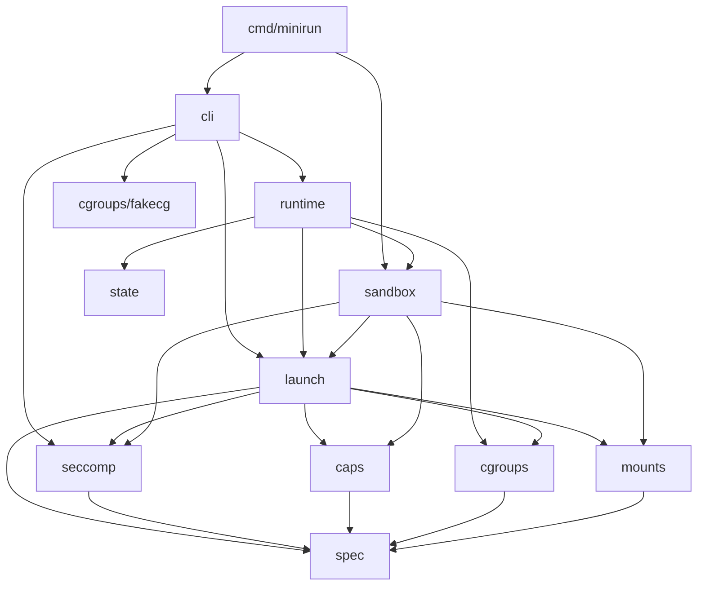
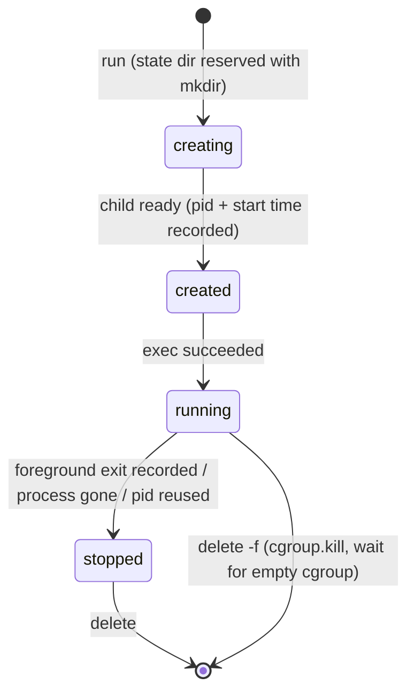

# minirun architecture

This document follows a container from `config.json` to `execve`, then
describes the seccomp compiler, the cgroup manager and the lifecycle state
machine, with the complexity of each step.

## 1. Packages and dependencies



Everything above `sandbox`, `runtime/launcher_linux.go`,
`caps/apply_linux.go` and `seccomp/install_linux.go` is pure computation
or file I/O and runs on any OS. Those four places are the only code that
issues namespace, mount, credential, capability or seccomp syscalls.

## 2. From bundle to plan (parent, host namespaces)

1. `spec.Parse` decodes `config.json` into the supported subset and, in a
   second pass over the generic JSON tree, walks it alongside the Go types
   (via reflection on `json` tags) to list every key minirun does not
   understand. Unknown keys become warnings, not errors, so configs written
   by `runc spec` load. O(size of config).
2. `spec.Validate` checks structure and reports all problems at once:
   absolute paths, namespace set (a mount namespace is mandatory), ID-map
   overlap (sort + sweep, O(m log m)), process uid/gid covered by the maps,
   rlimit names, hostname syntax, cgroup path without `..`.
3. `launch.Build` performs semantic conversion and aggregates errors from
   every component:
   - `caps.FromSpec`: names -> 64-bit masks, checking
     `effective ⊆ permitted ⊆ bounding` and
     `ambient ⊆ permitted ∩ inheritable`.
   - `mounts.FromSpec`: OCI option strings -> `mount(2)` flags, propagation
     flags and filesystem data; bind mounts with `ro`/`nosuid`/... get a
     second `MS_BIND|MS_REMOUNT` step because the kernel ignores those flags
     on the initial bind.
   - `seccomp.FromSpec` + `seccomp.Compile` (section 5).
   - `cgroups.Settings` (section 6).
   - overlay options (paths containing `,` `:` or `\` are rejected, since
     overlayfs would misparse them).
4. The plan is written to `<state>/<id>/plan.json` (it is reused by `exec`)
   and sent to the child over a pipe.

## 3. Process model and protocol

```mermaid
sequenceDiagram
  participant P as minirun run (parent)
  participant C as minirun __init (child)
  participant K as kernel
  P->>P: Build plan, create state dir, create cgroup, write limits
  P->>P: copy /proc/self/exe into a write-sealed memfd
  P->>K: clone(CLONE_NEWNS|NEWPID|NEWUTS|NEWIPC|NEWNET[|NEWUSER]) + execve(/proc/self/fd/N __init)
  K-->>C: pid 1 in the new namespaces
  P->>C: fd 3: plan JSON, then EOF
  C->>C: rprivate /, overlay, mounts, devices, pivot_root, masks, ro paths
  C->>C: hostname, lo up, rlimits
  C->>P: fd 5: {"type":"ready","pid":...}
  P->>P: record pid + /proc start time (status: created)
  P->>K: write pid to cgroup.procs (late join)
  P->>C: fd 4: start byte
  C->>C: chdir, umask, PATH lookup, mark fds >= 3 close-on-exec
  C->>C: drop privileges (section 4)
  C->>K: execve(process.args)
  K-->>P: fd 5 EOF (close-on-exec) = exec succeeded
  P->>P: status: running; foreground: wait, forward signals, record exit + OOM
```

Design points:

- **One binary, re-executed.** The child is minirun itself with a hidden
  first argument. `main.init` locks the main goroutine to the main OS
  thread and sets `GOMAXPROCS(1)` before anything else runs, because every
  later change (credentials, capabilities, seccomp) is per-thread and the
  final `execve` must come from the same thread.
- **Sealed memfd.** The child is executed from a write-sealed memfd copy of
  the binary, not from its path. During the window between re-exec and
  `execve` the helper is visible in the container's PID namespace, so a
  container process could open `/proc/<pid>/exe`; it would get an
  unwritable memfd instead of the host binary.
- **Status over a close-on-exec pipe.** Errors are reported as JSON lines;
  success is the pipe's EOF when `execve` closes the child's end. The
  parent can therefore distinguish "exec failed" from "the program started
  and exited quickly".
- **Late cgroup join.** The child is a Go program whose runtime starts
  several threads, and `pids.max` counts threads. The parent moves the
  child into the cgroup only after setup, just before releasing it to
  `execve`; cgroup migration is never refused by the pids controller, and
  after `execve` only the container program remains.
- **Cgroup namespaces are created late.** A cgroup namespace is rooted at
  the cgroup its creator is in. Because of the late join, `CLONE_NEWCGROUP`
  is never passed to `clone`; when the config asks for one, init sends
  `join-cgroup`, the parent moves it into the container cgroup and answers
  on the start pipe, and init calls `unshare(CLONE_NEWCGROUP)` before
  mounting anything.

### exec

`setns(CLONE_NEWNS)` refuses callers that share `fs_struct` with other
threads, and `setns(CLONE_NEWPID)` only affects children. minirun handles
both without cgo:

1. The CLI starts a goroutine, locks it to an OS thread and joins the
   container's IPC, UTS, network, PID and cgroup namespaces on that thread
   (`setns` on `/proc/<init>/ns/*`).
2. It forks `__exec` from that thread (a child inherits the forking
   thread's namespaces), passing the plan and an fd for
   `/proc/<init>/ns/mnt`. The goroutine never unlocks, so Go destroys the
   thread rather than reusing one that lives in foreign namespaces.
3. The helper calls `unshare(CLONE_FS)` on its locked thread (giving it a
   private `fs_struct`), `setns` into the mount namespace (which also sets
   its root and cwd to the container's), reports ready, is moved into the
   cgroup, then drops privileges and `execve`s exactly as init does.

A user namespace cannot be joined this way (`setns(CLONE_NEWUSER)` requires
a single-threaded process), so `exec` refuses user-namespaced containers.

## 4. Root filesystem and privilege drop (child)

Mount sequence (`sandbox/rootfs_linux.go`), all inside the new mount
namespace:

1. `mount("", "/", MS_REC|MS_PRIVATE)` (or the configured propagation) so
   nothing propagates back to the host.
2. `mount overlay` on `<state>/<id>/rootfs` with the bundle rootfs as lower
   and `<state>/<id>/{upper,work}`.
3. Each OCI mount in config order; targets resolved with `SecureJoin`
   (below); mount points created as directories, or empty files for file
   binds; bind remounts preserve flags the kernel locks on mounts inherited
   from a more privileged user namespace (read with `statfs`).
4. If `/dev` is a fresh tmpfs: bind-mount `/dev/{null,zero,full,random,urandom,tty}`
   from the host (works inside user namespaces, where `mknod` does not) and
   create the standard symlinks.
5. `chdir(rootfs); pivot_root(".", "."); umount2(".", MNT_DETACH); chdir("/")`:
   the old root is stacked under the new one and detached, so no
   `put_old` directory is needed in the image.
6. Masked paths (`tmpfs` read-only over directories, `/dev/null` over
   files), read-only paths (bind + read-only remount), optional read-only
   root.

`SecureJoin(root, path)` walks the path one component at a time with
`lstat`, expanding symlinks itself: absolute targets restart at `root`, `..`
stops at `root`, at most 255 expansions (ELOOP). Components after one that
does not exist are still checked one by one, because a later `..` can lead
back into existing directories (`proc -> missing/../evil` must follow
`evil`, not append it as text); the result is never itself a symlink, and
file mount points are created with `O_NOFOLLOW`. Cost O(components +
symlink expansions).

Privilege drop (`sandbox/security_linux.go`), on the locked thread:

1. Without `no_new_privs`: load seccomp now, while `CAP_SYS_ADMIN` is held
   (the kernel requires one or the other).
2. Drop every capability outside the bounding set (`PR_CAPBSET_DROP`; needs
   `CAP_SETPCAP`).
3. `PR_SET_KEEPCAPS=1`; `setgroups`; `setresgid`; `setresuid` - issued with
   `RawSyscall` so only this thread changes identity (Go's `syscall.Setuid`
   would broadcast to all threads); `PR_SET_KEEPCAPS=0`.
4. `capset` effective/permitted/inheritable; clear and raise ambient.
5. With `no_new_privs`: set it, then load seccomp last, so the filter only
   has to allow the final `execve`.
6. `execve` from the same thread.

## 5. Seccomp compiler

### Semantics

For a call to syscall S with arguments A on architecture X:

1. If `seccomp_data.arch != AUDIT_ARCH(X)`, or on x86-64 the number has the
   x32 bit (bit 30) set and is not -1: `KILL_PROCESS`.
2. Conditional rules for S in profile order; the first whose conditions all
   hold (64-bit unsigned compares; `MASKED_EQ` is `(a & v) == v2`) wins.
3. Otherwise the unconditional rule for S (at most one; conflicting
   unconditional actions are a validation error).
4. Otherwise the default action.

`seccomp.Evaluate` implements exactly this and is the specification the
compiler is tested against.

### Code generation

```text
      ld   [4]                ; arch
      jeq  #AUDIT_ARCH, ok, kill
ok:   ld   [0]                ; nr
      jset #0x40000000, x32, tree      (x86-64 only)
x32:  jeq  #0xffffffff, tree, kill
tree: balanced binary search over syscall-number ranges (jge)
      leaves jump directly to a shared "ret ACTION" or to an argument block
blk:  per conditional syscall: each rule's conditions as hi/lo 32-bit word
      comparisons, falling through to the next rule, then to the fallback
ret:  one "ret K" per distinct action
```

1. **Ranges.** Resolve names to numbers (names unknown to the architecture
   are skipped and reported). Sort the numbers and sweep the whole 32-bit
   space into maximal runs with one verdict, merging neighbours with equal
   unconditional actions and filling gaps with the default. The default
   profile's ~300 names collapse to 64 ranges on x86-64.
2. **Tree.** Recursively split the range list in half and emit
   `jge lo(mid)`; a half containing a single range is not emitted at all -
   the jump goes straight to that range's verdict label. Depth is
   ceil(log2 R), so dispatch costs O(log R) instructions (measured: avg
   11.0, max 17 for the default profile on x86-64, versus avg 187 for a
   linear `jeq` chain).
3. **64-bit argument tests.** Classic BPF is 32-bit; each condition loads
   the high word first (`args[i]` is little-endian on both architectures,
   so the high word is at offset 16+8i+4). `a > v` is
   `hi > vhi || (hi == vhi && lo > vlo)`; `>=` analogously; `<` and `<=`
   are the negations with swapped targets; `==`/`!=` compare both words;
   `MASKED_EQ` ANDs each word with the mask first.
4. **Assembly with relaxation.** Code is emitted with symbolic labels;
   every conditional jump names both targets (no implicit fall-through),
   which makes it safe to insert instructions after any jump. Conditional
   offsets are 8-bit; any target more than 255 instructions ahead is
   reached through a trampoline `ja` (32-bit offset) inserted right after
   the jump. Inserting can push other jumps out of range, so the pass
   repeats until a fixed point. Each pass is O(n) and only adds
   instructions, so it terminates; n <= 4096 (the kernel limit, enforced).
5. **Validation.** The output is checked against the kernel's load-time
   rules (`Validate`: permitted opcodes, aligned in-bounds loads, in-range
   forward jumps, final return, length) before it is returned.

Costs: compile O(N log N + C) for N names and C conditions, plus relaxation
passes; program size O(R + C). The interpreter (`seccomp.Run`) implements
every opcode `seccomp_check_filter` admits, including scratch memory, `X`
operands and division-by-zero semantics.

### Verification

- Property test: 800 random profiles per run (6-45 syscall pool, 1-25
  rules, random actions/errnos, 0-3 conditions with constants chosen to hit
  equality and word boundaries) x 60 random inputs each; compiled program
  in the interpreter must equal `Evaluate`.
- Fuzz target with the same property (`make fuzz`).
- Forced long jumps (150 conditional syscalls) to exercise trampolines.
- Golden disassembly; the 4096-instruction limit; name aliases.
- On a real kernel (integration): `Seccomp: 2`, configured errno observed,
  namespace creation denied.

## 6. cgroup v2

`cgroups.Settings` converts OCI resources (cgroup v1 vocabulary) to v2
files using runc's rules: `memory.limit -> memory.max`,
`reservation -> memory.low`, `swap` (memory+swap) `-> memory.swap.max =
swap - limit`, `shares -> cpu.weight = 1 + (shares-2)*9999/262142`,
`quota/period -> cpu.max`, `cpus/mems -> cpuset.*`, `pids.limit -> pids.max`;
`unified` entries are written verbatim (core `cgroup.*` files refused).

`Manager.Create` walks from the hierarchy root to the leaf; at each level it
reads `cgroup.controllers`, enables missing controllers with one write of
`+a +b` to `cgroup.subtree_control`, then `mkdir`s the next level. The leaf
must not exist (two containers never share a cgroup), and a failed run only
removes a cgroup it created. Errors carry hints for the classic failures:
`EBUSY` (no-internal-processes rule), `ENOENT` (controller not delegated),
`EINVAL` (value rejected).

The fake (`cgroups/fakecg`) reproduces those rules on a temp directory:
interface files appear on `mkdir` according to the parent's
`subtree_control`, writes never create files, read-only files reject
writes, limit values are validated, `subtree_control` enforces availability
and the no-internal-processes rule, `rmdir` fails while processes or
children remain, `cgroup.kill` empties `cgroup.procs`. Every write is
recorded, which is what `minirun plan --simulate-cgroups` prints.

## 7. State and lifecycle



- State files are replaced atomically (write temp, fsync, rename).
- Mutating operations hold an exclusive `flock` on `<state>/<id>/lock`.
- Status is derived on read: a `created`/`running` container whose init pid
  is missing, a zombie, or has a different start time (field 22 of
  `/proc/<pid>/stat`, parsed after the last `)` because the command name may
  contain spaces and parentheses) is `stopped`.
- `delete` refuses running containers unless `-f`; `-f` uses `cgroup.kill`
  (Linux 5.14+) and falls back to signalling each pid; it then retries
  `rmdir` for up to 5 s while killed processes exit.
- Removing the state directory never crosses a mount point (`st_dev` check
  over the tree before `RemoveAll`), so a mount that leaked into the state
  directory through shared propagation cannot be deleted through.
